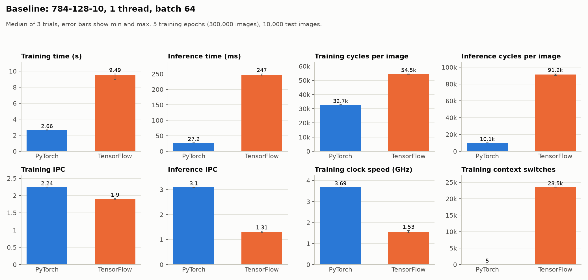
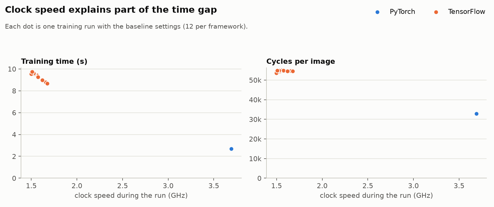
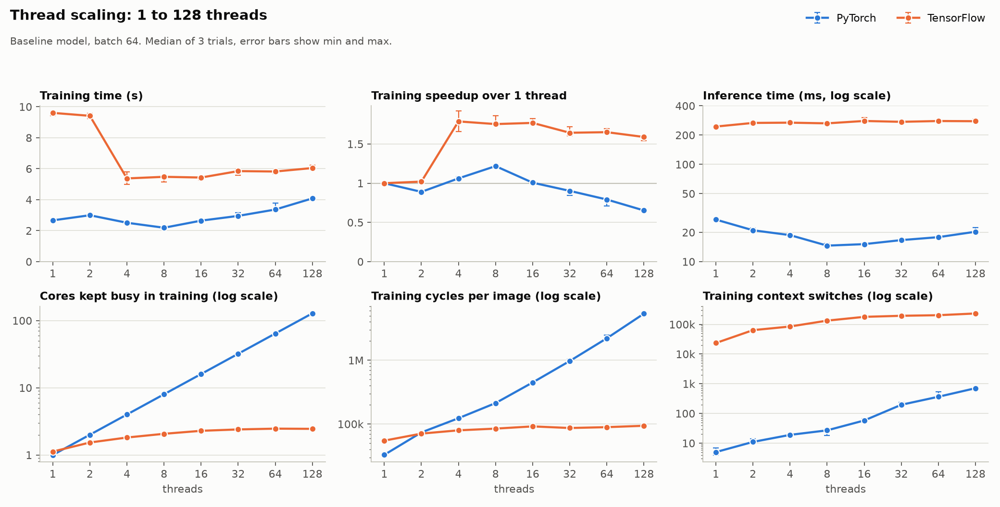
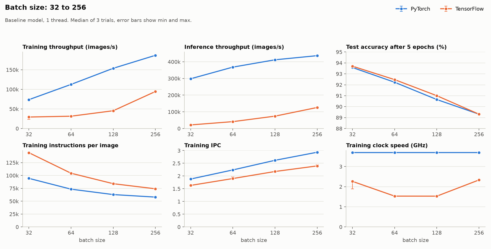
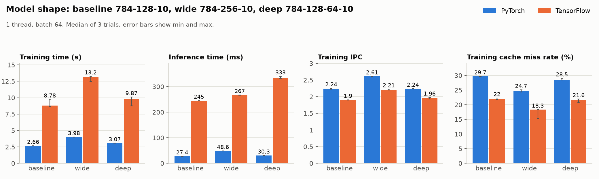

# PyTorch vs TensorFlow on the CPU: an MNIST performance study

CS3339 Computer Architecture, Fall 2026, Team 6.

We train and run the same small neural network in PyTorch and TensorFlow on
one CPU server and measure both the wall-clock time and what the processor
was doing, using Linux `perf stat` hardware counters. The goal is to explain
*why* one framework is faster, not only by how much.

- [Key findings](#key-findings)
- [Results](#results)
- [Methodology](#methodology)
- [Test machine](#test-machine)
- [Repository layout](#repository-layout)
- [Reproducing the results](#reproducing-the-results)
- [Limitations](#limitations)

## Key findings

All numbers are medians of three trials on the baseline configuration
(784-128-10 network, 1 thread, batch size 64, 5 epochs) unless stated.

| Metric (baseline)               | PyTorch 2.14.1 | TensorFlow 2.21.0 | TF / PT |
|---------------------------------|---------------:|------------------:|--------:|
| Training time, 5 epochs         | 2.66 s         | 9.49 s            | 3.6x    |
| Inference time, 10k images      | 27.2 ms        | 247 ms            | 9.1x    |
| Test accuracy                   | 92.2 %         | 92.5 %            | -       |
| Training cycles per image       | 32.7k          | 54.5k             | 1.7x    |
| Training instructions per image | 73.4k          | 103k              | 1.4x    |
| Training IPC                    | 2.24           | 1.90              | 0.85x   |
| Inference cycles per image      | 10.1k          | 91.2k             | 9.1x    |
| Inference IPC                   | 3.10           | 1.31              | 0.42x   |
| Clock speed while training      | 3.69 GHz       | 1.53 GHz          | 0.42x   |
| Context switches in training    | 5              | 23,535            | 4,700x  |

1. **PyTorch is faster in every condition we tested**, by 1.5x to 3.6x in
   training and 3.5x to 18x in inference, at the same accuracy.
2. **The training gap has two separate causes.** TensorFlow needs 1.7x more
   CPU cycles per image, and its cores also ran at less than half the clock
   speed (1.53 vs 3.69 GHz). Together with a slightly higher CPU utilization
   these account for the whole 3.6x: 1.66 x 2.41 / 1.12 = 3.57.
3. **The low clock speed goes together with how TensorFlow schedules work.**
   Its training loop made about 23,500 context switches against 5 for
   PyTorch, roughly five per training step. Our explanation is that a core
   which keeps going idle is not ramped up by the `schedutil` frequency
   governor. In inference, where TensorFlow barely switches, both frameworks
   ran at 3.69 GHz and the 9.1x gap is purely extra cycles per image.
4. **More threads help very little on a model this small.** TensorFlow peaks
   at 1.79x with 4 threads, PyTorch at 1.22x with 8 threads, and PyTorch at
   128 threads is 1.5x *slower* than at 1 thread.
5. **PyTorch's extra threads burn CPU without doing useful work.** It keeps
   every requested core busy (128 cores busy at 128 threads), so cycles per
   image grow 164x, from 32.8k to 5.39M. TensorFlow never uses more than
   about 2.5 cores no matter how many threads it is given.
6. **Larger batches are the most effective setting.** Going from batch 32 to
   256 raises training throughput 2.5x in PyTorch and 3.2x in TensorFlow,
   because the fixed per-step overhead is spread over more images
   (instructions per image fall by 39 % and 49 %). The price is accuracy
   after 5 epochs, which drops from about 93.6 % to 89.3 % in both
   frameworks since there are fewer weight updates.

## Results

The raw data, the merged tables and the scripts that draw these figures are
all in this repository (see [Repository layout](#repository-layout)). Bars
and points are medians of three trials; error bars span the lowest and
highest trial.

### Baseline



PyTorch executes fewer instructions per image and gets more of them through
the pipeline per cycle. The inference numbers are the clearest view of
framework overhead: with no backward pass and both CPUs at full clock speed,
TensorFlow still spends nine times as many cycles on each image.

### Clock speed



Each dot is one training run at the baseline settings (12 per framework,
taken from all four studies). TensorFlow's runs spread from 1.50 to 1.68 GHz
and their time follows the clock speed (8.66 to 9.74 s) while cycles per
image stay within 3 %. Reporting cycles next to seconds is what lets us
separate the work a framework does from the speed the core happened to run
at.

### Thread scaling



| Threads                 | 1    | 2    | 4    | 8    | 16   | 32   | 64   | 128  |
|-------------------------|-----:|-----:|-----:|-----:|-----:|-----:|-----:|-----:|
| PyTorch training (s)    | 2.67 | 3.00 | 2.51 | 2.19 | 2.65 | 2.95 | 3.37 | 4.08 |
| TensorFlow training (s) | 9.61 | 9.42 | 5.37 | 5.48 | 5.43 | 5.85 | 5.82 | 6.04 |

A 784-128-10 network at batch 64 multiplies matrices that are too small to
split across many cores, so the cost of coordinating threads quickly
outweighs the gain. The two frameworks fail in different ways: PyTorch's
worker threads stay busy on every core, while TensorFlow's thread pool
sleeps and pays for it in context switches (23.5k at 1 thread, 233k at 128)
and CPU migrations (1 to about 9,000). TensorFlow inference does not respond
to the thread setting at all (245 to 280 ms throughout), whereas PyTorch
inference improves from 27 ms to 15 ms at 8 threads.

### Batch size



| Batch size                      | 32    | 64    | 128   | 256   |
|---------------------------------|------:|------:|------:|------:|
| PyTorch training (images/s)     | 73.6k | 113k  | 154k  | 187k  |
| TensorFlow training (images/s)  | 29.3k | 31.4k | 45.4k | 94.5k |
| PyTorch inference (images/s)    | 298k  | 368k  | 412k  | 437k  |
| TensorFlow inference (images/s) | 21.5k | 41.2k | 74.1k | 126k  |

IPC rises with batch size in both frameworks (PyTorch 1.88 to 2.93,
TensorFlow 1.63 to 2.40) as more of the run is spent inside the dense
matrix kernels and less in per-step bookkeeping. TensorFlow gains the most
because it has the most per-step overhead to amortise.

### Model shape



| Model (parameters)            | PyTorch train | TensorFlow train | PyTorch accuracy | TensorFlow accuracy |
|-------------------------------|--------------:|-----------------:|-----------------:|--------------------:|
| baseline 784-128-10 (101,770) | 2.66 s        | 8.78 s           | 92.2 %           | 92.5 %              |
| wide 784-256-10 (203,530)     | 3.98 s        | 13.15 s          | 92.5 %           | 92.5 %              |
| deep 784-128-64-10 (109,386)  | 3.07 s        | 9.87 s           | 93.5 %           | 93.3 %              |

Doubling the hidden layer doubles the parameters but costs only 1.5x the
time in both frameworks, with higher IPC and a lower cache miss rate: the
larger matrix product is a more regular workload. The extra 64-unit layer
adds 12 to 16 % to training time and gives the best accuracy.

## Methodology

**Workload.** MNIST digits, fully connected networks with ReLU, SGD with
learning rate 0.01, cross-entropy loss, float32, 5 epochs over 60,000
training images and inference over the 10,000 test images.

**Studies.** 16 conditions, each measured for training and inference in 3
trials: 96 runs per framework, 192 in total.

| Study      | What changes                                      |
|------------|---------------------------------------------------|
| `baseline` | nothing: 784-128-10, 1 thread, batch 64           |
| `threads`  | 1, 2, 4, 8, 16, 32, 64, 128 intra-op threads      |
| `batch`    | batch size 32, 64, 128, 256                       |
| `models`   | baseline, wide (784-256-10), deep (784-128-64-10) |

**Keeping the comparison fair.** Both scripts share the same structure,
options and CSV columns, and match on:

- seed 42 for every run, no shuffling, batches taken in order
- Glorot/Xavier uniform starting weights and zero biases (the Keras
  default, applied explicitly in PyTorch)
- the same warm-up, which is not timed: 2 training batches (weights are then
  restored) and 1 inference batch
- the same inference loop: forward pass, conversion to NumPy and `argmax`
  per batch
- 1 inter-op thread, with the OpenMP/MKL/OpenBLAS thread variables set
  before the framework is imported

**Isolation.** Every measurement runs in a fresh Python process, so nothing
is cached between runs. Data loading, model building and warm-up happen
before the timer starts. The order of conditions alternates between trials
and the 1-minute load average is stored with each run.

**Hardware counters.** `mnist_tf_perf.py` and `mnist_torch_perf.py` start
`perf stat` with counting disabled and switch it on only around the timed
phase through perf's control FIFO, so imports and warm-up are not counted.
Ten events are recorded: task-clock, cycles, instructions, cache-references,
cache-misses, branches, branch-misses, context-switches, cpu-migrations and
page-faults. From these the scripts derive IPC, cache and branch miss rates,
CPU utilization (task-clock / wall time), effective clock speed
(cycles / task-clock) and per-image counts. The raw perf output of every run
is kept in `results/*/perf_raw/` so any CSV row can be checked against it.
[PERF_PROFILING_NOTES.md](PERF_PROFILING_NOTES.md) explains the counters and
formulas.

## Test machine

| Component  | Details                                             |
|------------|-----------------------------------------------------|
| Server     | Brooks (Texas State University CS department)       |
| CPU        | AMD EPYC 7V13 (Zen 3), 2 sockets x 64 cores, no SMT |
| Caches     | 512 KB L2 per core, 32 MB L3 per 8 cores            |
| Clock      | 1.5 to 3.72 GHz, `schedutil` governor               |
| OS         | Ubuntu 22.04.5, Linux 5.15, perf 5.15               |
| Python     | 3.10.12                                             |
| TensorFlow | 2.21.0 (CPU)                                        |
| PyTorch    | 2.14.1+cpu                                          |

Full details for each run are in `results/tensorflow/system_info.txt` and
`results/pytorch/system_info.txt`.

## Repository layout

```
tensorflow_mnist/
  mnist_tf.py               TensorFlow benchmark (timing only)
  mnist_tf_perf.py          same benchmark wrapped in perf stat
pytorch_mnist/
  mnist_torch.py            PyTorch benchmark (timing only)
  mnist_torch_perf.py       same benchmark wrapped in perf stat
analysis/
  compare.py                merges both result sets and writes the tables
  figures.py                draws the figures used above
  figures/                  baseline, threads, batch, models, clock PNGs
results/
  tensorflow/               runs and summary CSVs, raw perf output, system info, log
  pytorch/                  same for PyTorch
  combined_runs.csv         all 192 runs in one table
  comparison_summary.csv    median/min/max per framework and condition
  framework_comparison.csv  both frameworks side by side
PERF_PROFILING_NOTES.md     what each counter means and how metrics are derived
```

## Reproducing the results

The benchmarks need Linux; the perf versions also need `perf` and permission
to read hardware counters.

```bash
# TensorFlow
pip install tensorflow-cpu
python -c "import tensorflow as tf; tf.keras.datasets.mnist.load_data()"
python tensorflow_mnist/mnist_tf_perf.py --check
python tensorflow_mnist/mnist_tf_perf.py --study all --trials 3

# PyTorch
pip install torch --index-url https://download.pytorch.org/whl/cpu
python pytorch_mnist/mnist_torch_perf.py --check
python pytorch_mnist/mnist_torch_perf.py --study all --trials 3
```

`--check` confirms that every perf event can be counted before a long run.
Without perf, `mnist_tf.py` and `mnist_torch.py` take the same options and
record timing only. Results are written to `tf_results/` and
`torch_results/` (change with `--output`):

- `<framework>_runs.csv`: one row per run
- `<framework>_summary.csv`: mean, std, median, min and max per condition
- `system_info.txt`: CPU, OS, kernel and library versions
- `perf_raw/`: the untouched perf output of every run

Useful options: `--study baseline --trials 1` for a quick pilot,
`--thread-list`, `--batch-list` and `--model-list` to change the sweeps, and
`--train-samples` / `--epochs` to shrink runs. Thread counts above the number
of available CPUs are skipped. PyTorch downloads MNIST once to
`~/mnist-project/data` (change with `--data-dir`).

To rebuild the tables and figures from the committed results:

```bash
pip install -r analysis/requirements.txt
python analysis/compare.py
python analysis/figures.py
```

## Limitations

- **One machine, one model family.** The results describe small fully
  connected networks on a Zen 3 server. Larger or convolutional models
  spend more time in math kernels and less in framework overhead, so the
  gap may be smaller there.
- **Shared server.** Brooks is used by other students. The 1-minute load
  average reached 16 (of 128 cores) during the PyTorch run; the spread
  between trials stayed small.
- **Clock speed was not fixed.** We could not change the frequency
  governor, so wall-clock time mixes framework behaviour with frequency
  scaling. Cycle counts are not affected, which is why both are reported.
- **Counter multiplexing.** Ten events share the available hardware
  counters, so perf scales each count from the fraction of time it was
  measured (at least 65 % in every run).
- **Three trials per condition**, summarized with the median and the
  min-max range rather than confidence intervals.
- **Stock pip builds** of both frameworks were used, with no custom
  compilation or tuning.
